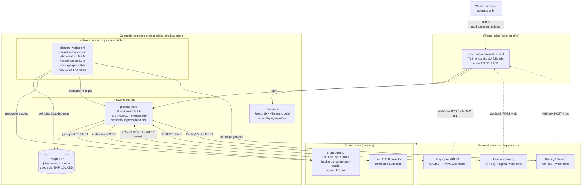

# 11 — System Architecture: digital-product-studio

**Produced by:** SLOT-2 architect
**Date:** 2026-10-12
**Status:** Complete — consumes slot-1 (docs/09-requirements.md, R1–R15) + slot-1.5 (docs/10-security-research.md, S1–S15, H1–H15). No code.

---

## 1. Component Diagram + Boundaries

Services (locked by slot-0 user decisions, doc 08 §7): **pipeline-core**, **pipeline-workers**, **admin-ui** ONLY. Editor tier deferred. Storage = shared-minio project (proj_9pg0PYaYOLsjdRvO), bucket `digital-product-studio`.



**Boundaries / trust zones:**

| Zone | Members | Trust assumptions |
|---|---|---|
| Edge | Pingap | Only TLS ingress, Amzanko CA, rate-limits, IP allowlist 172.19.0.0/16 |
| Core | pipeline-core, Postgres, admin-ui | Authenticated operators only (JWT role=admin). Webhook endpoints run with least-privilege service account (M6.6). |
| Worker | pipeline-workers | Untrusted-code zone (3rd-party CLIs). One job = one fresh container, `--rm`. No state carry-over. Strict egress (minio + platform IPs only, S10). |
| Storage | shared-minio | Scoped key; bucket policy = `arn:aws:s3:::digital-product-studio/*` only; versioning on; no DeleteObject for worker role. |
| External | Etsy/LS/Printify/Gelato/cf-image-gen | All egress TLS 1.3 via rustls; secrets in Openship `isSecret`. |

**Postgres vs SQLite — explicit decision:** Postgres, because (a) we need concurrent queue consumers (multiple pipeline-worker replicas) — Postgres `SELECT … FOR UPDATE SKIP LOCKED` is the canonical robust pattern and SQLite serializes all writers; (b) platform_listings + sales_events grow unboundedly with joins + JSONB queries (SQLite lacks JSONB index performance); (c) audit log volume; (d) sqlx's compile-time query validation is strongest on the Postgres driver. SQLite is rejected for any multi-writer, multi-replica deployment.

**S3 key scheme:**

```
s3://digital-product-studio/
  raw/<run_id>/<design_id>/<variant_id>.png                  # generation output
  curated/<niche_id>/<design_id>/<variant_id>.png           # approved
  products/<product_id>/<bundle_version>/<file>.pdf|.zip    # assembled
  mockups/<product_id>/<mockup_id>.png
  listings/<platform>/<platform_listing_id>/<artifact>      # per-listing pinned files
  tmp/<job_id>/…                                            # staging, 24h lifecycle
```

---

## 9. ADR List

**ADR-001: Rust + axum 0.8.9 for pipeline-core.** Chosen over Go (task-locked), over actix-web (tower ecosystem integration; axum 0.8 has no await-in-matching-path footguns), over POEM (smaller ecosystem). Compile-time routing, modularity, tower middleware reuse. Status: accepted.

**ADR-002: Postgres-only, no Redis.** Queue co-locates with state; `SELECT … FOR UPDATE SKIP LOCKED` suffices at our TPS. Removes Redis deploy/backup/secret surface. Status: accepted. Cost: long-poll semantics for admin-ui are implemented as Postgres `LISTEN/NOTIFY` + tokio broadcast, not Redis pub/sub.

**ADR-003: S3 key scheme partitioned by lifecycle (`raw/`, `curated/`, `products/`, `listings/`, `mockups/`, `tmp/`).** Prefix-bound IAM conditions allow MinIO policy `s3:prefix` enforcement per role (S10, M4.4). `tmp/` has 24h lifecycle expiry. Versioning retained 90 days. Status: accepted.

**ADR-004: Worker command-spec injection jail.** Never shell. JSON via file. Canonicalize under read/write roots. schemars 1.2.3-driven schema. Docker hardening H1–H15. Status: accepted — this is the biggest risk surface (slot-1.5 §2 command-injection deep dive).

**ADR-005: PlatformAdapter trait with reqwest + per-platform RateLimiter.** Uniform interface lets us add Creative Market or Printful later without touching orchestrator logic. Webhook verification is a trait method, not middleware — keeps platform signature quirks isolated. Status: accepted.

**ADR-006: Curation-as-product, not gate.** Curations table is first-class state (taxonomy, reviewer, time), feeds back into niche params, and is the only path from `raw/` to `curated/`. Status: accepted.

---

