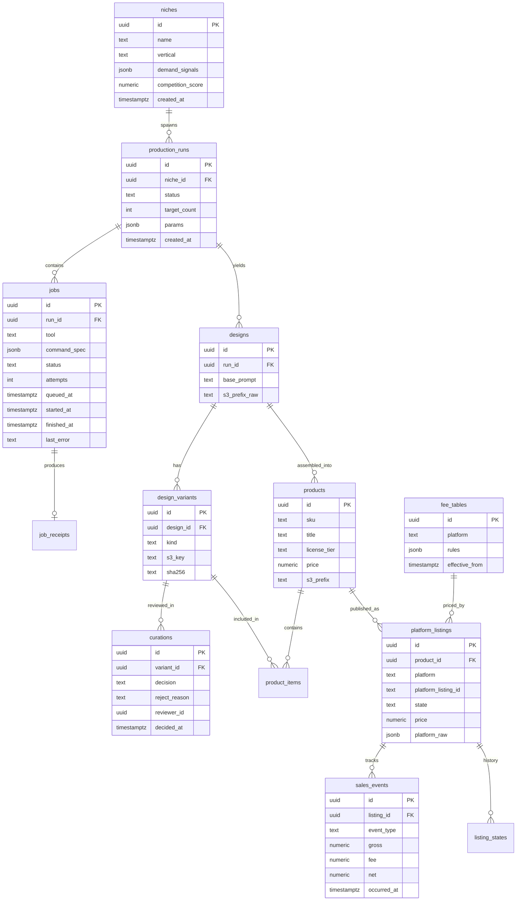
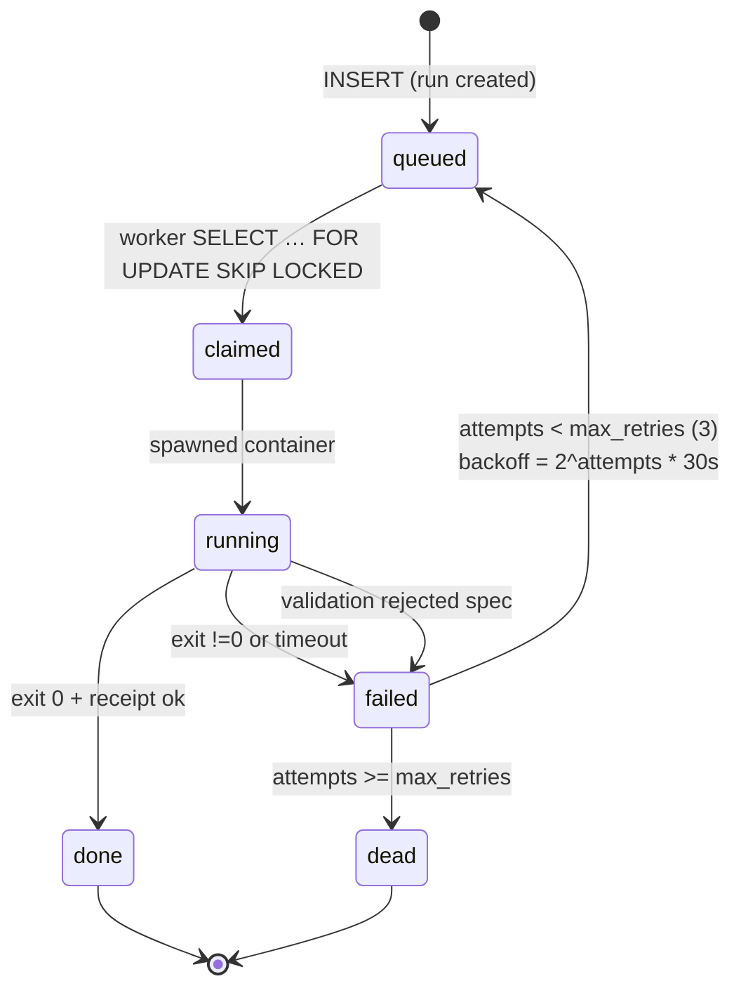
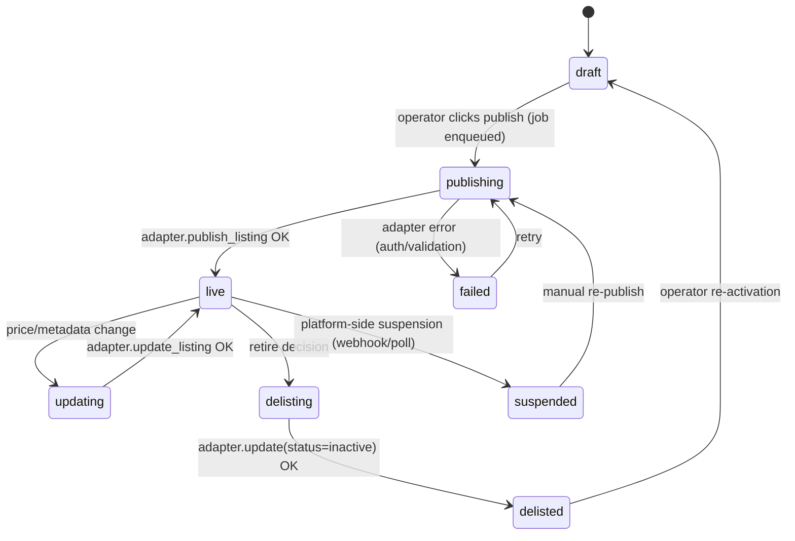

# 11 — System Architecture: digital-product-studio

**Produced by:** SLOT-2 architect
**Date:** 2026-10-12
**Status:** Complete — consumes slot-1 (docs/09-requirements.md, R1–R15) + slot-1.5 (docs/10-security-research.md, S1–S15, H1–H15). No code.

---

## 2. Data Model

All tables in Postgres 16. PKs are `uuid` (gen_random_uuid()). `timestamptz` everywhere. JSONB only for truly schemaless payloads (command_spec, platform_raw).

**Job state machine:**

Transition rules:
- `queued → claimed` is atomic via `SELECT … FOR UPDATE SKIP LOCKED` — no double-claim.
- `running` jobs have a **lease**: `lock_expires_at`. If no heartbeat for 120s, reaper moves running → failed (attempts++). Guards against crashed workers.
- `failed → queued` only when `attempts < 3`. Backoff is stored in `next_attempt_at`; claim query filters `next_attempt_at <= now()`.
- `done` requires an execution receipt row (worker evidence per M2.3).

**Listing state machine:**

---

