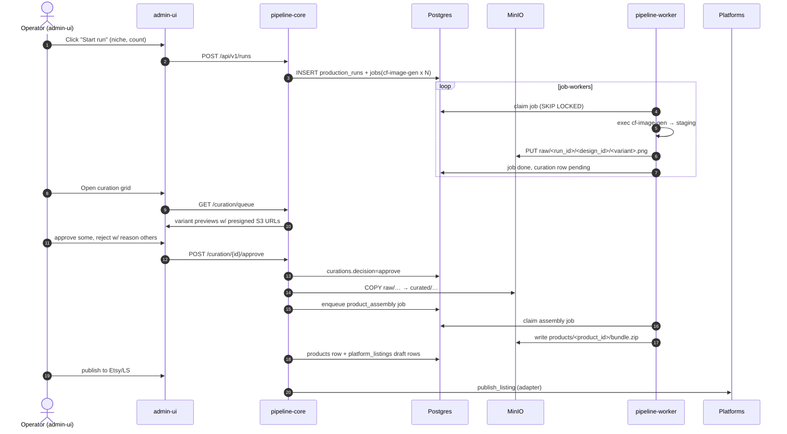

# 11 — System Architecture: digital-product-studio

**Produced by:** SLOT-2 architect
**Date:** 2026-10-12
**Status:** Complete — consumes slot-1 (docs/09-requirements.md, R1–R15) + slot-1.5 (docs/10-security-research.md, S1–S15, H1–H15). No code.

---

## 5. Worker Execution Model

**Queue choice: Postgres-only (no Redis).** Rationale:
1. We already operate Postgres for state. Adding Redis is another failure domain, another secret set, another backup strategy — and gives us nothing we need at our throughput (≲ 50 jobs/min).
2. `SELECT … FOR UPDATE SKIP LOCKED` is exactly the primitive a worker-pull queue needs and is used in production by Oban/Que/River at thousands of jobs/sec. Our volume is far smaller.
3. Atomic claim + status transition in one transaction = no lost jobs on worker crash (lease expiry in reaper loop).
4. Single-binary deployment. Less infra. Less operational risk.

**Worker pull loop:**
```
loop {
    let job = db::claim_one_job(filter: next_attempt_at<=now, lease=120s)?;
    match job {
        Some(j) => execute(j)?;          // spawns container
        None => sleep(jitter(500ms..2s)) // back-off when empty
    }
}
```

**Command-spec schema (S14, M2.1/M2.2):**

```json
{
  "$schema": "http://json-schema.org/draft/2020-12/schema",
  "title": "JobCommandSpec",
  "type": "object",
  "required": ["tool", "args"],
  "properties": {
    "tool": {"enum": ["cf-image-gen", "photocraft-cli", "vectorcraft-cli"]},
    "subcommand": {"enum": ["run","batch","convert","info","commands","mcp","serve","droplet"]},
    "args": {"type": "object"},
    "timeout_secs": {"type": "integer", "minimum": 1, "maximum": 1800, "default": 300},
    "expected_outputs": {"type":"array", "items": {"type":"string"}}
  },
  "additionalProperties": false
}
```

The `tool`-specific `args` are themselves validated against per-tool schemars-derived JSON Schemas (schemars 1.2.3, verified live, 2026-10-12) generated from the CLI command registries (858 commands photocraft, 732 vectorcraft).

**Injection jail (S14 concretely):**
1. `--params` JSON is NEVER shell-interpolated. It is serialized to `/workspace/params/job-<uuid>.json` and passed via `--params-file` (M2.2).
2. CLI args are constructed as `Vec<String>` and executed via `tokio::process::Command` with `.arg().arg()` — never `.shell()`.
3. Input/output paths must canonicalize under `--automation-read-root=/workspace/read` and `--automation-write-root=/workspace/write` (CLI-enforced, verified in pivot doc §277).
4. Mounts: `/workspace/read` (ro, nosuid,noexec,nodev), `/workspace/write` (rw, nodev,noexec). Host has no other visibility in.
5. Containers `read_only: true`, `network_disabled` on H6 custom bridge restricted to minio + platform IPs.

**Retry / backoff policy:** job.attempts++; next_attempt_at = now() + 30s * 2^attempts; cap 3 attempts → dead. Lease expiry 120s without heartbeat → failed w/ attempt consumed. Worker emits execution receipt: `{job_id, command_hash, args_hash, exit_code, stdout_sha256, stderr_sha256, output_files:[{path, sha256, size}]}` → `job_receipts` row (M2.3).

**Concurrency:** static N replicas (compose `replicas: 4`), each with semaphores per tool-class: cf-image-gen=2, photocraft-cli=4, vectorcraft-cli=2 in-flight. Total CPU/memory bounds via Docker `deploy.resources.limits` (S9).

---

## 6. Curation Flow



**Curation-as-product** decision: every approved variant carries `decision`, `reviewer_id`, `decided_at`, and reject taxonomy (style mismatch / artifact / license / off-niche / duplicate). The taxonomy feeds back into niche params.

---

