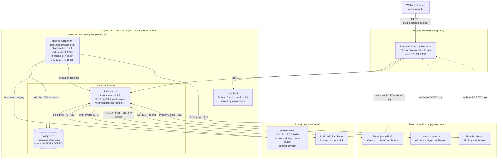
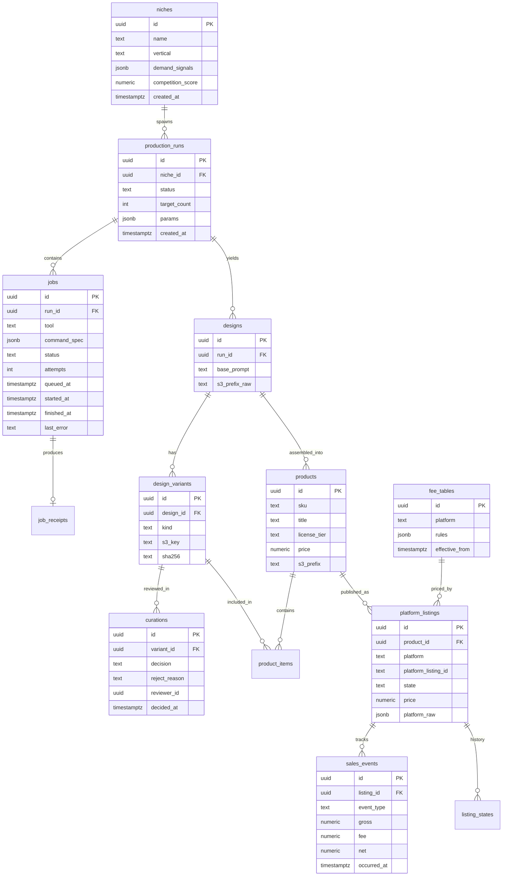
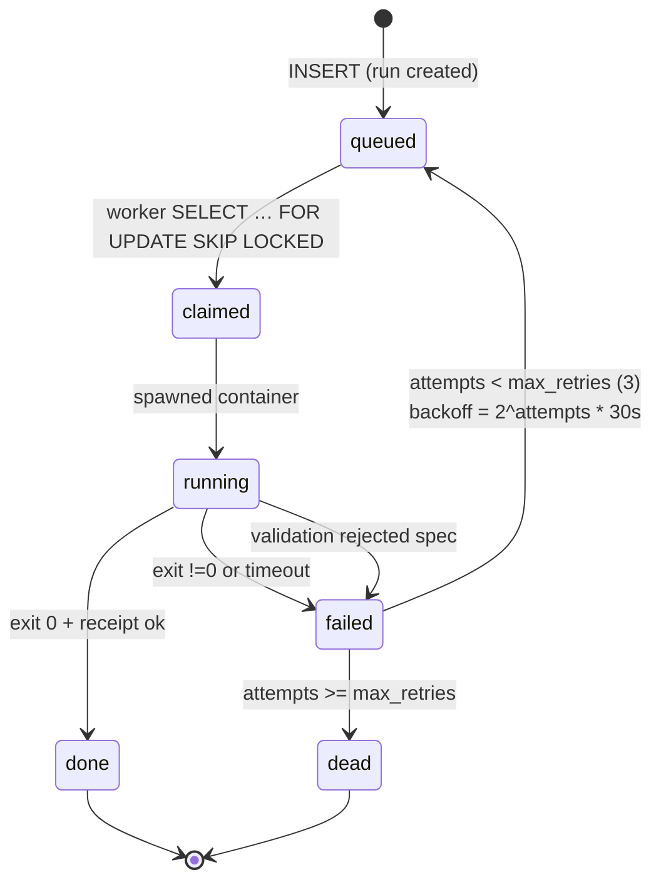
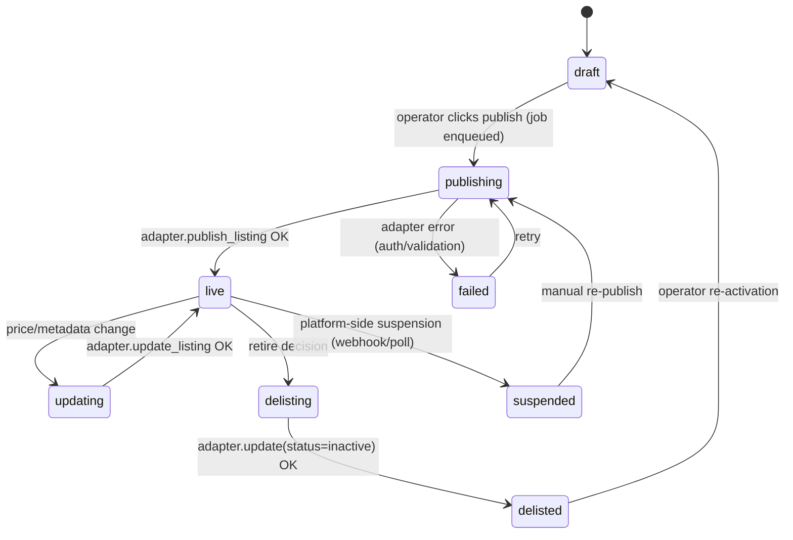
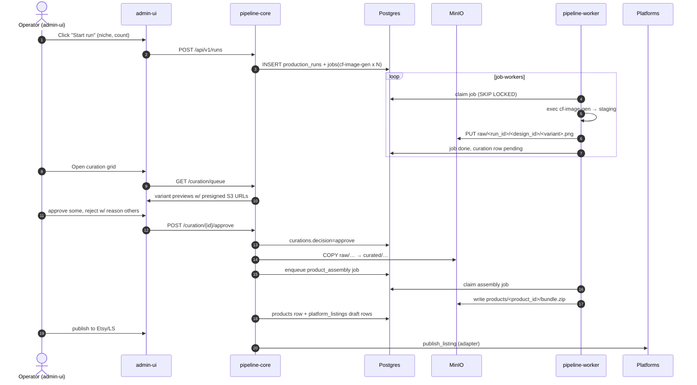

# 11 — System Architecture: digital-product-studio

**Produced by:** SLOT-2 architect
**Date:** 2026-10-12
**Status:** Complete — consumes slot-1 (docs/09-requirements.md, R1–R15) + slot-1.5 (docs/10-security-research.md, S1–S15, H1–H15). No code.

---

## 1. Component Diagram + Boundaries

Services (locked by slot-0 user decisions, doc 08 §7): **pipeline-core**, **pipeline-workers**, **admin-ui** ONLY. Editor tier deferred. Storage = shared-minio project (proj_9pg0PYaYOLsjdRvO), bucket `digital-product-studio`.



**Boundaries / trust zones:**

| Zone | Members | Trust assumptions |
|---|---|---|
| Edge | Pingap | Only TLS ingress, Amzanko CA, rate-limits, IP allowlist 172.19.0.0/16 |
| Core | pipeline-core, Postgres, admin-ui | Authenticated operators only (JWT role=admin). Webhook endpoints run with least-privilege service account (M6.6). |
| Worker | pipeline-workers | Untrusted-code zone (3rd-party CLIs). One job = one fresh container, `--rm`. No state carry-over. Strict egress (minio + platform IPs only, S10). |
| Storage | shared-minio | Scoped key; bucket policy = `arn:aws:s3:::digital-product-studio/*` only; versioning on; no DeleteObject for worker role. |
| External | Etsy/LS/Printify/Gelato/cf-image-gen | All egress TLS 1.3 via rustls; secrets in Openship `isSecret`. |

**Postgres vs SQLite — explicit decision:** Postgres, because (a) we need concurrent queue consumers (multiple pipeline-worker replicas) — Postgres `SELECT … FOR UPDATE SKIP LOCKED` is the canonical robust pattern and SQLite serializes all writers; (b) platform_listings + sales_events grow unboundedly with joins + JSONB queries (SQLite lacks JSONB index performance); (c) audit log volume; (d) sqlx's compile-time query validation is strongest on the Postgres driver. SQLite is rejected for any multi-writer, multi-replica deployment.

**S3 key scheme:**

```
s3://digital-product-studio/
  raw/<run_id>/<design_id>/<variant_id>.png                  # generation output
  curated/<niche_id>/<design_id>/<variant_id>.png           # approved
  products/<product_id>/<bundle_version>/<file>.pdf|.zip    # assembled
  mockups/<product_id>/<mockup_id>.png
  listings/<platform>/<platform_listing_id>/<artifact>      # per-listing pinned files
  tmp/<job_id>/…                                            # staging, 24h lifecycle
```

---

## 2. Data Model

All tables in Postgres 16. PKs are `uuid` (gen_random_uuid()). `timestamptz` everywhere. JSONB only for truly schemaless payloads (command_spec, platform_raw).



**Job state machine:**



Transition rules:
- `queued → claimed` is atomic via `SELECT … FOR UPDATE SKIP LOCKED` — no double-claim.
- `running` jobs have a **lease**: `lock_expires_at`. If no heartbeat for 120s, reaper moves running → failed (attempts++). Guards against crashed workers.
- `failed → queued` only when `attempts < 3`. Backoff is stored in `next_attempt_at`; claim query filters `next_attempt_at <= now()`.
- `done` requires an execution receipt row (worker evidence per M2.3).

**Listing state machine:**



---

## 3. API Surface (REST, /api/v1)

All responses JSON. Errors shaped `{error: {code, message, correlation_id}}`. All mutating routes require JWT `role=admin` and emit audit events (M1.3). Body limit 2MB (S1).

| Method | Route | Purpose | R/S trace |
|---|---|---|---|
| GET | /api/v1/health | liveness | — |
| GET | /api/v1/niches | list niches w/ demand scores | R10 |
| POST | /api/v1/niches | create niche | R10 |
| GET | /api/v1/niches/{id} | detail | — |
| PATCH | /api/v1/niches/{id} | edit | — |
| DELETE | /api/v1/niches/{id} | delete (cascade guard if runs exist) | — |
| POST | /api/v1/runs | spawn production run (niche_id, target_count, params) | R6, R10 |
| GET | /api/v1/runs | list with status/progress | — |
| GET | /api/v1/runs/{id} | detail, job breakdown | — |
| POST | /api/v1/runs/{id}/cancel | soft cancel (drains queued; running leases expire) | — |
| GET | /api/v1/curation/queue | paginated previews of decided=pending | curation flow §6 |
| POST | /api/v1/curation/{variant_id}/approve | approve → curated S3 copy job | — |
| POST | /api/v1/curation/{variant_id}/reject | reject with reason | — |
| GET | /api/v1/catalog | browse designs/products/bundles | R15 |
| GET | /api/v1/products/{id} | detail with listings | — |
| POST | /api/v1/products/{id}/publish | enqueue publish to platform(s) | R3,R4 |
| POST | /api/v1/listings/{id}/delist | retire | — |
| POST | /api/v1/listings/{id}/reprice | apply pricing ladder | R9,R15 |
| GET | /api/v1/analytics/performance | per-listing views/sales/margin | R9 |
| GET | /api/v1/analytics/runs | cost per run | — |
| GET | /api/v1/settings/credentials | list credential refs (metadata only) | S11 |
| PUT | /api/v1/settings/credentials/{platform} | store Openship isSecret ref (NOT the secret itself) | S11 |
| GET | /api/v1/settings/fee-tables | list | R9 |
| PUT | /api/v1/settings/fee-tables/{platform} | update fee rules | R9 |
| POST | /api/v1/webhooks/{platform} | webhook ingress (unauth but signature-verified) | S13, R14 |

Webhook ingress policy: no authentication header, but signature verification (S13) is performed BEFORE any DB write. Replay protection via `processed_webhook_ids` cache (M6.2).

---

## 4. Adapter Trait Design

```text
trait PlatformAdapter {
    async fn publish_listing(&self, product: &Product, files: &[UploadFile])
        -> Result<PublishReceipt>;
    async fn update_listing(&self, listing_id: &str, patch: ListingPatch)
        -> Result<()>;
    async fn upload_digital_file(&self, listing_id: &str, file: UploadFile)
        -> Result<PlatformFileId>;
    async fn fetch_orders(&self, since: DateTime) -> Result<Vec<Order>>;
    async fn fetch_stats(&self, listing_id: &str) -> Result<ListingStats>;
    fn verify_webhook(&self, body: &[u8], headers: &HeaderMap)
        -> Result<VerifiedWebhook, VerificationError>;
    fn rate_limiter(&self) -> &RateLimiter;   // token bucket per adapter
}
```

| Platform | Auth | Rate-limit strategy | Webhook signature |
|---|---|---|---|
| **Etsy v3** | OAuth2 `authorization_code` w/ PKCE; refresh token (90d); proactive refresh ≥5 min before expiry (M5.6); access token 1h | Token bucket: 5 req/s sustained, 10 burst (well under Etsy 1000/hr); exponential backoff on 429 with `Retry-After` honored | HMAC-SHA256 over body using webhook secret |
| **Lemon Squeezy** | Bearer API key; rotation manual via admin console | 150 req/min bucket (assumed conservative; UNVERIFIED — public docs don't publish) | `X-Signature` HMAC-SHA256 |
| **Printify** | `Authorization: Bearer <api_key>`; account-scoped | 600 req/min firm cap (R5); bucket 8 req/s with burst 20 | Webhook HMAC |
| **Gelato** | API key (`X-API-KEY`); some flows OAuth2 | Conservative 4 req/s + jittered backoff; UNVERIFIED public cap | HMAC signature |

Common adapter infrastructure: shared HTTP client (reqwest w/ rustls ≥0.23.45, S4), shared `TokenBucket` (tower Layer), shared `RetryPolicy` (exp backoff + jitter, max 5 attempts, only on 429/5xx).

---

## 5. Worker Execution Model

**Queue choice: Postgres-only (no Redis).** Rationale:
1. We already operate Postgres for state. Adding Redis is another failure domain, another secret set, another backup strategy — and gives us nothing we need at our throughput (≲ 50 jobs/min).
2. `SELECT … FOR UPDATE SKIP LOCKED` is exactly the primitive a worker-pull queue needs and is used in production by Oban/Que/River at thousands of jobs/sec. Our volume is far smaller.
3. Atomic claim + status transition in one transaction = no lost jobs on worker crash (lease expiry in reaper loop).
4. Single-binary deployment. Less infra. Less operational risk.

**Worker pull loop:**
```
loop {
    let job = db::claim_one_job(filter: next_attempt_at<=now, lease=120s)?;
    match job {
        Some(j) => execute(j)?;          // spawns container
        None => sleep(jitter(500ms..2s)) // back-off when empty
    }
}
```

**Command-spec schema (S14, M2.1/M2.2):**

```json
{
  "$schema": "http://json-schema.org/draft/2020-12/schema",
  "title": "JobCommandSpec",
  "type": "object",
  "required": ["tool", "args"],
  "properties": {
    "tool": {"enum": ["cf-image-gen", "photocraft-cli", "vectorcraft-cli"]},
    "subcommand": {"enum": ["run","batch","convert","info","commands","mcp","serve","droplet"]},
    "args": {"type": "object"},
    "timeout_secs": {"type": "integer", "minimum": 1, "maximum": 1800, "default": 300},
    "expected_outputs": {"type":"array", "items": {"type":"string"}}
  },
  "additionalProperties": false
}
```

The `tool`-specific `args` are themselves validated against per-tool schemars-derived JSON Schemas (schemars 1.2.3, verified live, 2026-10-12) generated from the CLI command registries (858 commands photocraft, 732 vectorcraft).

**Injection jail (S14 concretely):**
1. `--params` JSON is NEVER shell-interpolated. It is serialized to `/workspace/params/job-<uuid>.json` and passed via `--params-file` (M2.2).
2. CLI args are constructed as `Vec<String>` and executed via `tokio::process::Command` with `.arg().arg()` — never `.shell()`.
3. Input/output paths must canonicalize under `--automation-read-root=/workspace/read` and `--automation-write-root=/workspace/write` (CLI-enforced, verified in pivot doc §277).
4. Mounts: `/workspace/read` (ro, nosuid,noexec,nodev), `/workspace/write` (rw, nodev,noexec). Host has no other visibility in.
5. Containers `read_only: true`, `network_disabled` on H6 custom bridge restricted to minio + platform IPs.

**Retry / backoff policy:** job.attempts++; next_attempt_at = now() + 30s * 2^attempts; cap 3 attempts → dead. Lease expiry 120s without heartbeat → failed w/ attempt consumed. Worker emits execution receipt: `{job_id, command_hash, args_hash, exit_code, stdout_sha256, stderr_sha256, output_files:[{path, sha256, size}]}` → `job_receipts` row (M2.3).

**Concurrency:** static N replicas (compose `replicas: 4`), each with semaphores per tool-class: cf-image-gen=2, photocraft-cli=4, vectorcraft-cli=2 in-flight. Total CPU/memory bounds via Docker `deploy.resources.limits` (S9).

---

## 6. Curation Flow



**Curation-as-product** decision: every approved variant carries `decision`, `reviewer_id`, `decided_at`, and reject taxonomy (style mismatch / artifact / license / off-niche / duplicate). The taxonomy feeds back into niche params.

---

## 7. Deployment View

Openship compose project `digital-product-studio` on the same Docker host at 172.19.0.1.

```yaml
# SKETCH (no real values; canonical compose is devops-slot deliverable)
# networks:
#   internal: 172.19.x.0/24 — core, postgres, admin-ui
#   worker-egress: 172.19.y.0/24 — workers only; iptables DROP except minio+API
# services:
#   pipeline-core  : ports: "172.19.0.1:8080:8080"   (REST)
#   admin-ui       : ports: "172.19.0.1:4173:80"     (static nginx)
#   pipeline-worker: deploy.replicas=4, no published ports
#   postgres       : internal only
# secrets (Openship isSecret):
#   ETSY_REFRESH_TOKEN, LS_API_KEY, PRINTIFY_API_KEY, GELATO_API_KEY,
#   MINIO_ACCESS_KEY, MINIO_SECRET_KEY, JWT_SIGNING_KEY,
#   WEBHOOK_SECRET_ETSY, WEBHOOK_SECRET_LS, WEBHOOK_SECRET_PRINTIFY, WEBHOOK_SECRET_GELATO
```

CI/CD: GitHub Actions (org repo) builds/pushes:
- `pipeline-core:<semver>` (Rust musl static + debian:bookworm-slim runtime)
- `admin-ui:<semver>` (npm ci → vite build → nginx:alpine COPY)
- `pipeline-worker-base:photocraft-0.7.0` (zero-compile: download release tarball → verify sha256 → extract binary → COPY into debian:bookworm-slim — recipe from doc 08 §7 step 2)
- Tagged digest-pinned refs deployed via Openship update (H10).

Pingap: certificates.studio (myCA fullchain per doc 08 §7 verification note — operator picks myCA over self-signed so the webtop browser trusts without exception), upstream `studioUpstream → http://172.19.0.1:4173` (admin-ui), `/api/*` → `http://172.19.0.1:8080`. Allowlist `172.19.0.0/16`. HSTS.

Bucket binding: re-use the shared-minio project (proj_9pg0PYaYOLsjdRvO); add `digital-product-studio:accesskey:secretkey` to its MINIO_SITES secret, redeploy. Bucket versioning + lifecycle `tmp/` 24h expiry enabled.

---

## 8. Tech-Stack Picks (versions verified live 2026-10-12)

| Component | Crate / Package | Version | Docs | Reason |
|---|---|---|---|---|
| Rust HTTP web framework | axum | **0.8.9** | <https://docs.rs/axum/0.8.9> | tokio-native, tower middleware, macro-free routing. Latest stable. |
| Async runtime | tokio | **1.53.2** | <https://docs.rs/tokio/1.53.2> | Unified 1.x line; avoids the deprecated tokio-* split crates flagged by slot-1.5. |
| Postgres driver / ORM-free | sqlx | **0.9.0** | <https://docs.rs/sqlx/0.9.0> | Compile-time-checked queries (S3), SKIP LOCKED first-class, ≥0.8.1 fixes RUSTSEC-2024-0363. |
| S3 client | object_store | **0.14.2** | <https://docs.rs/object_store/0.14.2> | Chosen OVER aws-sdk-s3: smaller dep tree, first-class MinIO (S3-compatible endpoint), Apache governance, no AWS-account SDK weight. Verdict PASS w/ monitoring (slot-1.5 §3.1). |
| HTTP client (adapters) | reqwest | **0.13.5** | <https://docs.rs/reqwest/0.13.5> | rustls ≥0.23.45 pulls h2 ≥0.4.16 → satisfies S4, S5. |
| Middleware | tower-http | **0.7.1** | <https://docs.rs/tower-http/0.7.1> | Mistyped earlier as 0.5/0.6; current 0.7.1 is what axum 0.8.9 pairs with. |
| Tracing | tracing | **0.1.44** | <https://docs.rs/tracing/0.1.44> | + tracing-subscriber ≥0.3.20 (S6). OTLP export. |
| JSON Schema gen | schemars | **1.2.3** | <https://docs.rs/schemars/1.2.3> | Drives worker command-spec validation (S14). |
| TLS | rustls | **0.23.45** | <https://docs.rs/rustls/0.23.45> | RUSTSEC-2026-0285 fix; default for reqwest via `default-tls`. |
| HTTP/2 (transitive) | h2 | **0.4.20** | <https://docs.rs/h2/0.4.20> | ≥0.4.16 satisfies S5 (verified live — was 0.4.16 min). |
| Web framework | react | **19.3.0** | <https://www.npmjs.com/package/react> | + react-dom 19.3.0. |
| Web build | vite | **8.3.4** | <https://www.npmjs.com/package/vite> | NOT 5.x/6.x per slot-1.5 §3.2 (Vite advisories conditional) — current 8.x line is clean for our build-only use. |
| Data fetching | @tanstack/react-query | **5.104.2** | <https://www.npmjs.com/package/@tanstack/react-query> | Core only — NO @tanstack/start-*, form-core, arktype-adapter (slot-1.5 §3.2). |
| UI components | shadcn/ui | copy-paste components | <https://ui.shadcn.com> | Audit copies for `dangerouslySetInnerHTML` (S15). |

`Cargo.toml`/`package.json` pinning decisions themselves belong to implementation; this doc fixes the version FLOORS shown above.

---

## 9. ADR List

**ADR-001: Rust + axum 0.8.9 for pipeline-core.** Chosen over Go (task-locked), over actix-web (tower ecosystem integration; axum 0.8 has no await-in-matching-path footguns), over POEM (smaller ecosystem). Compile-time routing, modularity, tower middleware reuse. Status: accepted.

**ADR-002: Postgres-only, no Redis.** Queue co-locates with state; `SELECT … FOR UPDATE SKIP LOCKED` suffices at our TPS. Removes Redis deploy/backup/secret surface. Status: accepted. Cost: long-poll semantics for admin-ui are implemented as Postgres `LISTEN/NOTIFY` + tokio broadcast, not Redis pub/sub.

**ADR-003: S3 key scheme partitioned by lifecycle (`raw/`, `curated/`, `products/`, `listings/`, `mockups/`, `tmp/`).** Prefix-bound IAM conditions allow MinIO policy `s3:prefix` enforcement per role (S10, M4.4). `tmp/` has 24h lifecycle expiry. Versioning retained 90 days. Status: accepted.

**ADR-004: Worker command-spec injection jail.** Never shell. JSON via file. Canonicalize under read/write roots. schemars 1.2.3-driven schema. Docker hardening H1–H15. Status: accepted — this is the biggest risk surface (slot-1.5 §2 command-injection deep dive).

**ADR-005: PlatformAdapter trait with reqwest + per-platform RateLimiter.** Uniform interface lets us add Creative Market or Printful later without touching orchestrator logic. Webhook verification is a trait method, not middleware — keeps platform signature quirks isolated. Status: accepted.

**ADR-006: Curation-as-product, not gate.** Curations table is first-class state (taxonomy, reviewer, time), feeds back into niche params, and is the only path from `raw/` to `curated/`. Status: accepted.

---

## 10. Handoff

**Inputs consumed:**

| Source doc | IDs consumed | Integrated in |
|---|---|---|
| docs/09-requirements.md (slot-1) | R1–R15 | §1–§8 |
| docs/10-security-research.md (slot-1.5) | S1–S15, H1–H15, M1.x–M6.x, C1–C6 | §1–§7, §9 |

**Requirement → component mapping:**

| Req | Component(s) |
|---|---|
| R1 | niche shortlist stored as `niches` rows; enforced by admin-ui form + `CHECK (vertical IN (...))` |
| R2 | adapter implementations carry doc URLs as struct-level comments |
| R3 | EtsyAdapter OAuth2 refresh worker (§4) |
| R4 | LemonSqueezyAdapter Bearer header (§4) |
| R5 | PrintifyAdapter token bucket 600/min (§4) |
| R6 | cf-image-gen worker capacity + run sizing (§5 concurrency caps) |
| R7 | photocraft-cli toolclass command-spec schema (§5) |
| R8 | vectorcraft-cli toolclass command-spec schema (§5) |
| R9 | fee_tables + /api/v1/settings/fee-tables (§2, §3) |
| R10 | POST /api/v1/runs + production_runs spawn (§3, §6) |
| R11 | CI image recipe — sha256 verification step (§7) |
| R12 | worker Dockerfile prohibition of GUI libs (§7) |
| R13 | Etsy adapter file-size guard 250MB (§4) |
| R14 | POST /api/v1/webhooks/{platform} (§3) + adapter verify_webhook (§4) |
| R15 | products.license_tier + pricing ladder, /api/v1/catalog (§2, §3) |

**Security requirement → design element mapping:**

| S | Design element |
|---|---|
| S1 | §3 body limit (tower_http::limit) |
| S2 | §3 JWT role check middleware |
| S3 | §1/§2 sqlx::query! only (Postgres) |
| S4 | §4 reqwest+rustls 0.23.45 pin (§8) |
| S5 | §8 h2 0.4.20 ≥0.4.16 |
| S6 | §8 tracing-subscriber ≥0.3.20 |
| S7 | §5 worker Dockerfile USER 1000 + read_only |
| S8 | §5 compose cap_drop ALL + no-new-privileges |
| S9 | §5 compose deploy.resources.limits |
| S10 | §1, §5 worker-egress network + iptables rule |
| S11 | §3 settings routes + §7 Openship isSecret |
| S12 | §7 Pingap myCA cert + HSTS |
| S13 | §3, §4 verify_webhook per platform |
| S14 | §5 command-spec JSON Schema (schemars), allowlist, --params-file, --automation-root |
| S15 | §1 admin-ui production build (vite sourcemap off, CSP, shadcn audit) |

**Handoff to next slot(s):** this doc feeds slot-3+ (backend-engineer + frontend-engineer + devops) — the explicit deliverable contract is the §10 mapping tables plus §8 version pins.

**Known UNVERIFIED items (carried from slot-1.5, not silently resolved):**
- Exact crate versions beyond the floors cited — implementation `cargo build` must snapshot `Cargo.lock` and re-verify against RustSec.
- Exact npm versions for shadcn/ui transitive components — package.json not yet written.
- MinIO bucket policy JSON for scoped key — needs `mc policy get` at deploy time.
- Pingap cert pattern (myCA vs self-signed) — operator decision at deploy time.
- gVisor/Kata availability on the Docker host — falls back to seccomp + cap-drop if absent.
- Gelato rate-limit exact cap (public docs don't publish).

---

*End of architecture memo. All 10 sections present. 15/15 R-requirements mapped. 15/15 S-requirements traced. State machines drawn. Worker jail explicit. All versions cited with doc links. *
